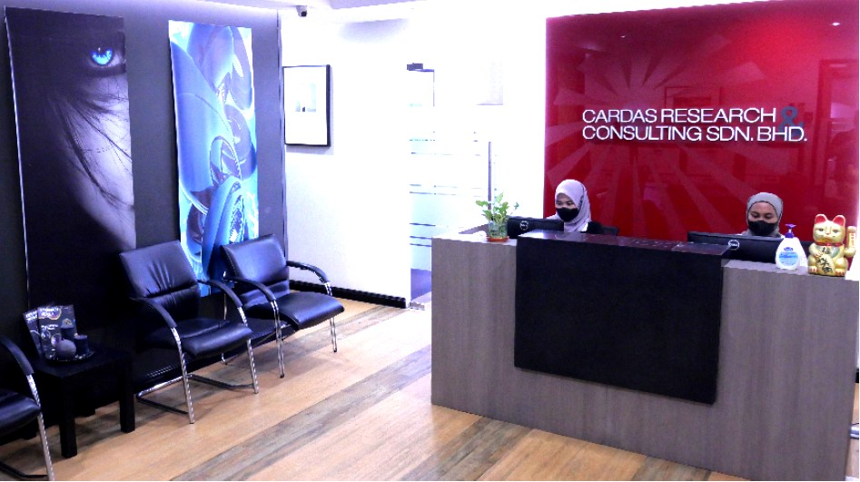

---
Experience
---

[Home](index.md) | [Projects](projects.md) | [Skills](skills.md)

# My Experiences

My experiences extend beyond academic studies to include
industry exposure, international learning, and opportunities
for personal and professional development.

Explore the experiences that have contributed to my academic
journey, practical skills, and broader understanding of the
world.

---

## Industrial Training at Cardas Research & Consulting Group

**Industry Experience | Research and Data Support**

*9 March 2026 – 8 March 2027*

My industrial training has given me exposure to consumer research, industry research, and mystery shopping activities.
Through these assignments, I have gained practical experience in data collection, Excel-based reporting, data validation, database filtering, and research coordination.

  

**Highlights**
- Consumer research and data collection
- Industry research and spreadsheet analysis
- Data checking and report consistency
- Database management and project support

[Explore This Experience →](experience/crcg.md)

---

## Chinese Government Scholarship International Summer School

**Hebei University | Baoding, Hebei, China**

*25 July – 10 August 2025*

An international academic and cultural exchange programme that broadened my exposure to Big Data, Artificial Intelligence, Data Analytics, Digital Finance, E-commerce, and Digitalization.

Beyond the classroom, I explored traditional Chinese culture, participated in cultural activities, and had the opportunity to deliver the programme's closing speech.

  

**Highlights**
- Academic exposure to data and digital technologies
- Cultural exploration and international exchange
- Communication and public speaking experience
- Personal growth and cross-cultural awareness

[Explore This Experience →](experience/hebei-summer-school.md)

---

 

[Back to Previous Page](README.md)

## More About My Journey

Each experience has helped me develop different perspectives,
strengthen my transferable skills, and prepare for future
opportunities in data analytics and related fields.
