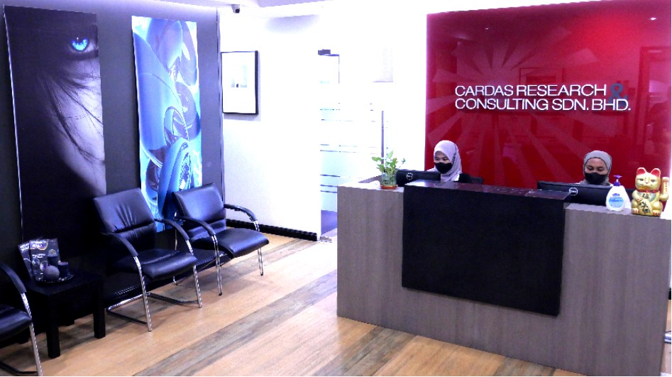
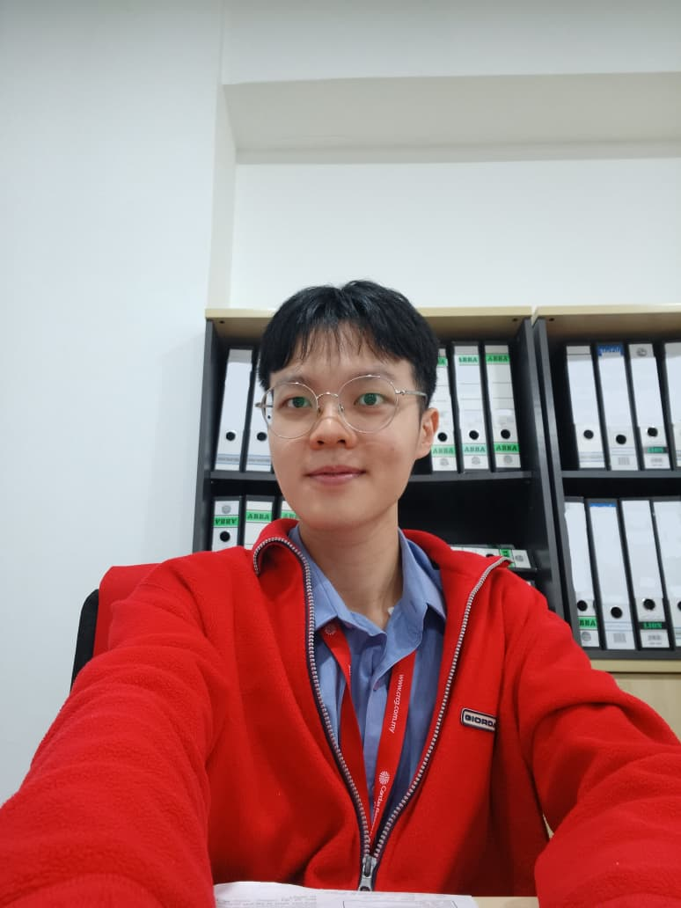
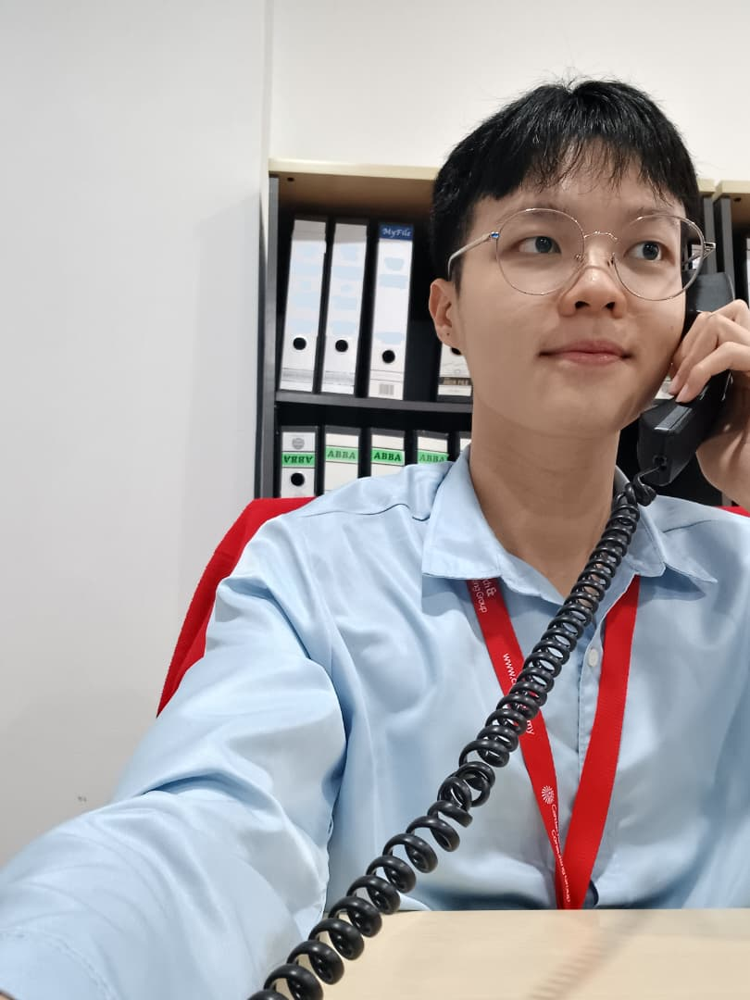

---
title: Professional Experience
---

[Home](../index.md) | [Projects](../projects.md) | [Skills](../skills.md)

# Industrial Training at Cardas Research & Consulting Group

  

### Research & Data Support Intern

**Cardas Research & Consulting Group (CRCG)**

Petaling Jaya, Selangor, Malaysia

9 March 2026 – 8 March 2027

Industrial Training

---

## About My Experience

Working across Consumer Research, Industry Research and Mystery Shopping, I gained practical experience in market research, data collection, information verification and research reporting.

This experience helped me understand how accurate and well-organised data supports research quality and business decisions.

---

## Key Responsibilities

### 1. Consumer Research

- Conducted telephone surveys to collect consumer opinions and feedback on food delivery platforms.
- Recorded and updated survey responses according to research requirements.
- Monitored data collection progress and maintained accurate records.

### 2. Industry Research

- Collected and organised industry information from different sources.
- Used Microsoft Excel to perform calculations, prepare charts and update research reports.
- Reviewed figures and source information to identify inconsistencies.

### 3. Mystery Shopping

- Compared internal database records with individual mystery shopping reports.
- Identified and highlighted discrepancies for further review.
- Supported shopper screening, recruitment and coordination through database reviews, telephone calls and email communication.
  

  

  

---

## Skills Applied

Microsoft Excel · Data Collection · Data Validation · Research Reporting · Information Management · Communication · Attention to Detail

---

## What I Gained

My internship strengthened my understanding of the importance of data accuracy before analysis begins.

I also learned how research information is collected, checked and organised, and how clear communication supports reliable research work.

---

## Acknowledgements

I would like to express my sincere appreciation to Cardas Research & Consulting Group for providing me with the opportunity to undertake my industrial training and gain practical workplace experience.

I am also grateful to my supervisor, project leaders and colleagues for their guidance, support and willingness to share their knowledge throughout my training.

Their assistance has helped me understand the working environment of the research industry and develop skills that will be valuable for my future academic and professional journey.

---

[← Back to Previous Page](../experience.md)
