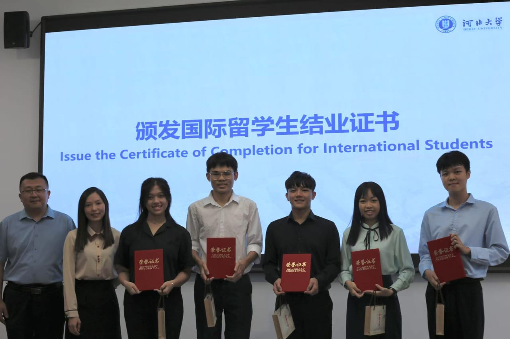
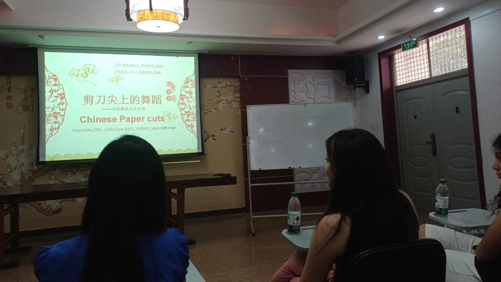
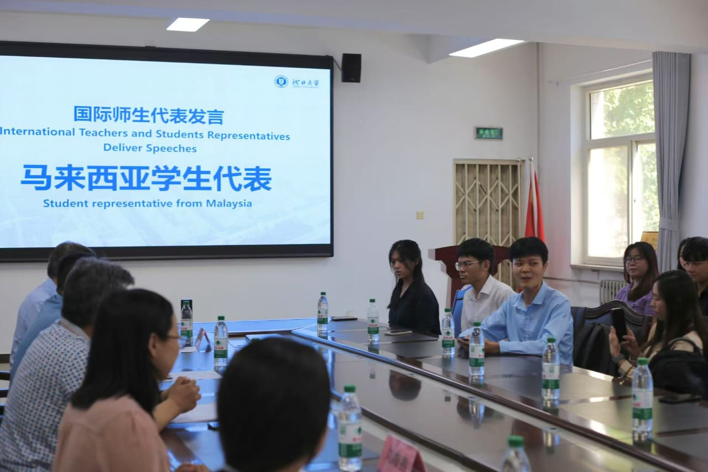
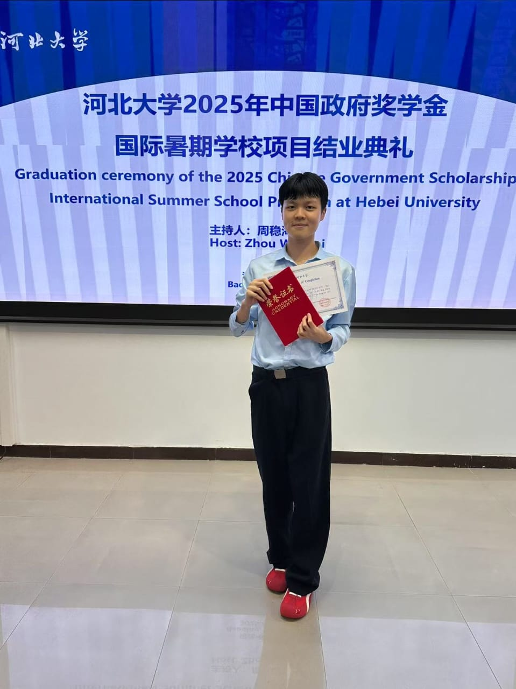
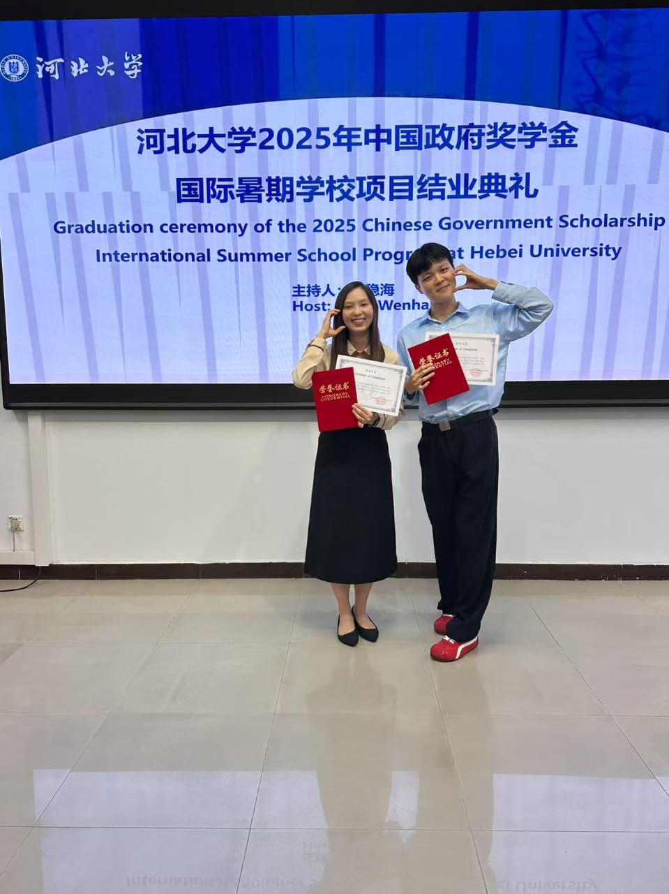

---
title: Industrial Training at Cardas Research & Consulting Group
permalink: /experience/hebei-summer-school/
---

[Home](../README.md) | [Projects](../projects.md) | [Skills](../skills.md)

# Industrial Training at Cardas Research & Consulting Group

  

### Gaining Practical Experience in Market Research, Data Verification and Research Operations

**Company:** Cardas Research & Consulting Group (CRCG)

**Location:** Petaling Jaya, Selangor, Malaysia

**Internship Period:** 9 March 2026 – 8 March 2027

**Position:** Industrial Trainee – Research & Data Support

**Departments Involved:** Consumer Research, Industry Research and Mystery Shopping

---

## Overview

  

During my industrial training at Cardas Research & Consulting Group (CRCG), I have had the opportunity to gain practical experience in different areas of market research and research operations. Throughout the internship, I have been exposed to three main departments: Consumer Research, Industry Research and Mystery Shopping.

My responsibilities involve collecting research information, organising and reviewing data, supporting industry report preparation, verifying data consistency, and assisting with shopper screening and coordination. These activities have allowed me to understand how research information is collected, processed, checked and prepared to support business and client decision-making.

As a Data Analytics student, this experience has helped me connect my academic knowledge with real workplace practices. In particular, I have developed a better understanding of the importance of data accuracy, information reliability, systematic checking and effective communication throughout the research process.

Beyond technical tasks, the internship has also provided opportunities to improve my communication, problem-solving, teamwork and time-management skills through collaboration with colleagues and project leaders.

---

## 1. Consumer Research

### Understanding Consumer Opinions Through Data Collection

My first exposure to the Consumer Research Department involved supporting telephone survey activities to collect opinions and feedback from users of food delivery platforms.

The purpose of this activity was to gather consumer responses and understand their experiences with the services provided by different platforms.

**Key Responsibilities**

- Conducted telephone surveys to collect consumer opinions, feedback and experiences.
- Followed daily data collection targets and research requirements.
- Clarified responses when additional information was required.
- Recorded and updated survey information in the company's system.
- Monitored calling progress and maintained accurate collection records.

**Learning Experience**

Through this activity, I gained practical exposure to primary data collection and understood how survey responses become part of a research dataset.

I also learned that collecting data requires more than simply asking questions. It involves clear communication, careful listening, accurate recording and consistency in following research guidelines.

This experience strengthened my understanding of data collection as an important foundation for subsequent analysis and research findings.

---

## 2. Industry Research

### Supporting Industry Research and Report Preparation

In the Industry Research Department, I was involved in supporting the preparation and updating of syndicated industry reports. My responsibilities included collecting relevant industry information, organising data using Microsoft Excel, performing calculations and preparing charts for report presentation.

The tasks provided opportunities to work with industry-related information and understand how collected data is transformed into organised findings for research reports.

  

**Key Responsibilities**

- Collected and organised relevant information from different sources for industry research.
- Used Microsoft Excel to arrange data, perform calculations and summarise information.
- Prepared pie charts and bar charts to present data in a more understandable format.
- Reviewed figures and source information to identify inconsistencies.
- Consulted project leaders when clarification was required regarding differences between sources.
- Updated report information and charts based on reviewed data.
- Checked report formatting, consistency and presentation before submission.

**Learning Experience**

This department helped me improve my ability to organise and interpret information using Microsoft Excel. I gained practical experience in working with different data categories, summarising figures and presenting information through visualisations.

One important lesson was understanding that data collected from different sources may contain inconsistencies. Therefore, checking the reliability of information and clarifying uncertain figures are essential steps before incorporating them into a research report.

I also developed a better appreciation of how data visualisation can help communicate industry information and make research findings easier to understand.

---

## 3. Mystery Shopping

### Data Verification, Quality Assurance and Shopper Coordination

My experience in the Mystery Shopping Department involved two main areas: data verification and shopper screening and coordination.

These activities provided exposure to both the data quality checking process and the operational preparation required for mystery shopping projects.

  

### 3.1. Data Verification and Quality Checking

One of my responsibilities was to review and verify the consistency of information between the company's system records and individual mystery shopping reports.

The purpose of this task was to ensure that the information recorded in the system matched the corresponding details in the reports.

**Key Responsibilities**

- Compared company system records with individual mystery shopping reports.
- Reviewed assigned brands and reporting periods.
- Identified inconsistencies between the system data and report information.
- Highlighted discrepancies in the relevant checking materials.
- Reported identified issues to the supervisor or project leader for further review.
- Organised and arranged checking documents according to the assigned requirements.

**Learning Experience**

This task strengthened my understanding of data quality assurance, particularly the importance of accuracy and consistency when handling research information.

I learned that even small discrepancies between records and reports require attention because inaccurate information may affect the reliability of research records and subsequent reporting.

Through repeated checking activities, I improved my attention to detail, ability to compare information systematically and confidence in identifying inconsistencies.

### 3.2 Shopper Screening and Coordination

Apart from data verification, I was also involved in screening and contacting potential shoppers for mystery shopping assignments, particularly for financial services-related projects.

The process involved identifying suitable shoppers based on the project requirements and ensuring that their profiles and availability were appropriate for the assigned locations.

**Key Responsibilities**

- Contacted potential shoppers to introduce project opportunities and confirm their interest.
- Screened shopper profiles based on project requirements.
- Reviewed relevant database information to identify suitable candidates.
- Confirmed shopper details and availability for assigned locations.
- Updated calling status and recruitment progress.
- Communicated with project leaders regarding shopper availability and location-related matters.
- Followed up with shoppers through email when further coordination was required.

I also received guidance from the project leader before participating in a financial services mystery shopping visit. This provided an opportunity to understand the assessment process from a shopper's perspective and gain practical exposure to the service evaluation process.

**Learning Experience**

Through these responsibilities, I developed a better understanding of the operational preparation involved in mystery shopping projects.

I learned that selecting suitable shoppers requires careful screening, clear communication and proper coordination. In addition, keeping accurate recruitment records and updating project progress are important for supporting project arrangements.

This experience also helped me improve my communication and coordination skills when dealing with different individuals and handling project-related requirements.

---

## 4. Tools and Technologies

### Microsoft Excel

Used to organise research information, perform calculations, prepare charts, compare records, identify discrepancies and manage shopper information.

### Microsoft Word

Used for preparing, reviewing and organising research-related documents and reports.

### Email and Workplace Communication Tools

Used to communicate with shoppers, follow up on project arrangements and share updates or issues with colleagues and project leaders.

These tools have helped me understand how digital applications support daily research operations and improve the organisation and management of information.

---

## 5. Skills and Professional Development

### Data Verification and Quality Assurance

Developed the ability to compare information across different sources, identify inconsistencies and pay attention to data accuracy.

### Microsoft Excel and Data Organisation

Improved my practical experience in organising information, performing calculations and formulas, preparing charts and managing structured data.

### Research and Information Gathering

Gained exposure to collecting consumer feedback, gathering industry information and supporting market research activities.

### Communication and Coordination

Improved my communication skills through telephone surveys, shopper screening, email follow-ups and discussions with colleagues and project leaders.

### Problem-Solving and Attention to Detail

Learned to identify unclear information, investigate discrepancies and seek clarification when necessary.

---

## 6. Reflection

### Connecting Academic Knowledge with Workplace Experience

My industrial training at Cardas Research & Consulting Group has been a valuable opportunity to understand how research activities are carried out in a professional working environment.

Throughout my exposure to Consumer Research, Industry Research and Mystery Shopping, I have gained experience in different stages of the research process, from collecting information and organising data to checking records and supporting research operations.

As a Data Analytics student, one of my main takeaways is that data analytics does not begin with analysis alone. Data collection, organisation, validation and quality checking are equally important in ensuring that the information used for analysis is reliable.

The internship has also helped me recognise the importance of communication and collaboration in completing research tasks. Working with colleagues and project leaders has taught me to ask questions when clarification is needed, manage assigned responsibilities and adapt to different working requirements.

---

## Acknowledgements

I would like to express my sincere appreciation to Cardas Research & Consulting Group for providing me with the opportunity to undertake my industrial training and gain practical workplace experience.

I am also grateful to my supervisor, project leaders and colleagues for their guidance, support and willingness to share their knowledge throughout my training.

Their assistance has helped me understand the working environment of the research industry and develop skills that will be valuable for my future academic and professional journey.

  
  

---

[← Back to Previous Page](../experience.md)
