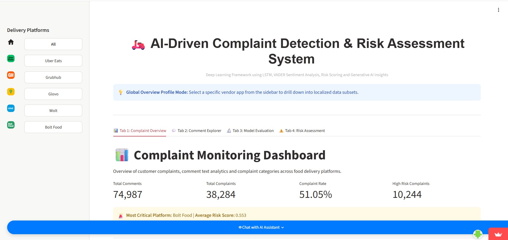
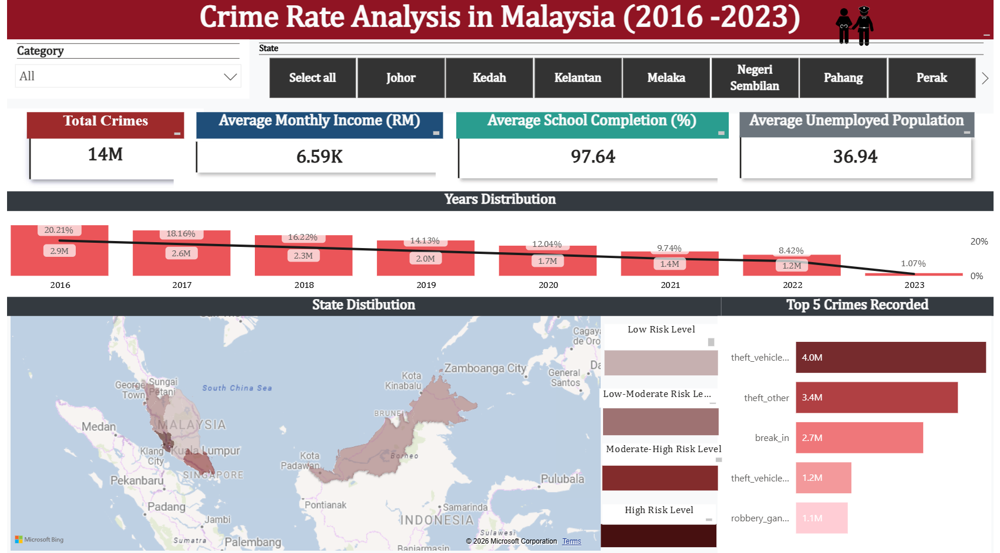
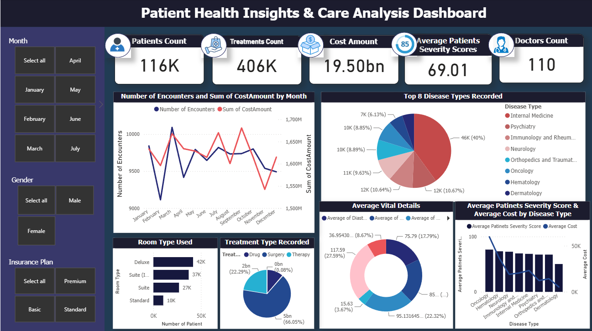
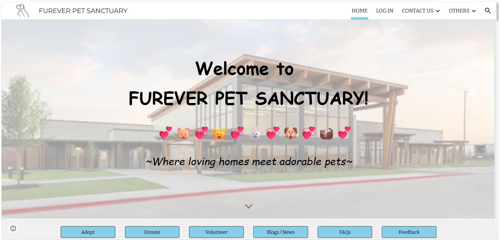

---
Projects
---

[Home](index.md) | [Experience](experience.md) | [Skills](skills.md)

# My Projects

## Turning Data into Findings, and Findings into Action

I use academic and independent projects to explore real-world questions through data analysis, programming and technology.

My work covers business analytics, SQL, data warehousing, machine learning and data visualization. Each project reflects how I approach a problem, work with data and communicate the results.

---

## An AI-Driven Big Data and Deep Learning Framework for Complaint Detection and Risk Severity Assessment on Online Food Delivery Platforms

  

**Key components**
- Text preprocessing and exploratory data analysis
- LSTM-based customer complaints classification
- Complaint categorization and risk severity scoring
- Streamlit dashboard for presenting insights

**Tools:** Python, VS Code, Streamlit, Canva

[View Full Case Study](projects/food-delivery-risk.md)

---

## Sentiment Analysis on Balancing Innovation and Security in Generative AI (GenAI)

  

**Key components**
- Text preprocessing and sentiment labelling
- TF-IDF feature extraction
- Comparison of machine learning classifiers
- Topic modelling to identify discussion themes

**Tools:** Python, Microsoft Power Point

[View Full Case Study](projects/generative-ai-sentiment.md)

---

## Analyzing Crime Distribution and Prevention Strategies in Malaysia

  

**Key components**
- Data preprocessing, cleaning, and predictive model development
- Model performance evaluation and analytical interpretation
- Interactive Streamlit application and dashboard development
- Predictive analytics and spatial analysis of crime distribution

**Tools:** PostgreSQL, Python, Power BI, Streamlit

[View Full Case Study](projects/crime-analysis.md)

---

## Design and Implementation of a Data Warehouse for Healthcare Analytics to Support Public Health Decision-Making

  

**Key components**
- Healthcare data preprocessing, cleaning, and ETL pipeline development
- Snowflake Schema design with fact and dimension tables
- SQL-based OLAP operations for multidimensional data analysis
- Interactive Power BI dashboard development and healthcare insights visualization

**Tools:** PostgreSQL, Python, Power BI, Canva

[View Full Case Study](projects/healthcare.md)

---

## Paw Track Adoption System: Furever Pet Sanctuary Site

  

**Key components**
- Database design and organization for pet and adoption information
- Website structure and content organization
- User-friendly interface design to simulate real-world pet sanctuary operations
- Adoption information, donation, volunteer, and communication features

**Tools:** Google Sites, Google Forms

[View Full Case Study](projects/paw-track.md)

---

## Leveraging Data Analytics For Urban Planning: Towards Sustainable, Smart And Resilient City Amid Responsible Energy Consumption

  

**Key components**
- Independent game development using visual programming
- Scratch programming logic and interactive gameplay design
- Implementation of game elements to communicate sustainable urban planning concepts
- Team collaboration in developing a competition website

**Tools:** Scratch, Google Sites

[View Full Case Study](projects/urban-game.md)

---

[Back to Home](index.md)

