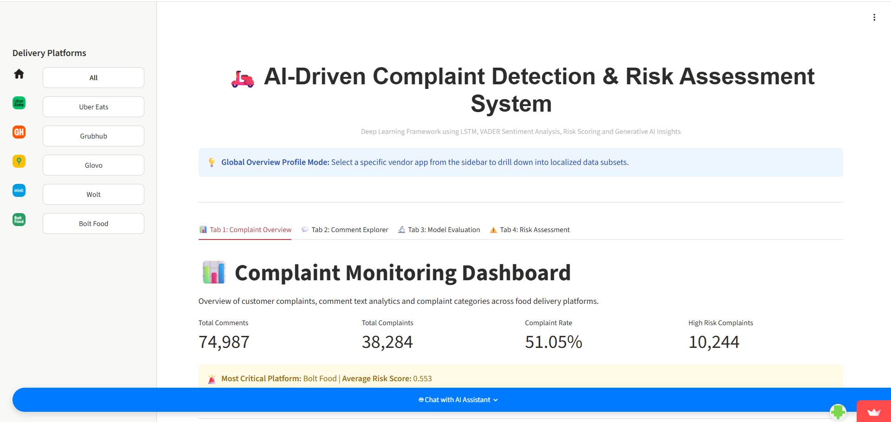
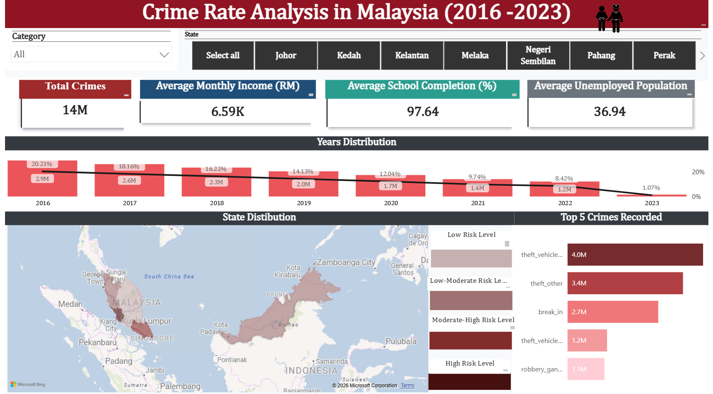
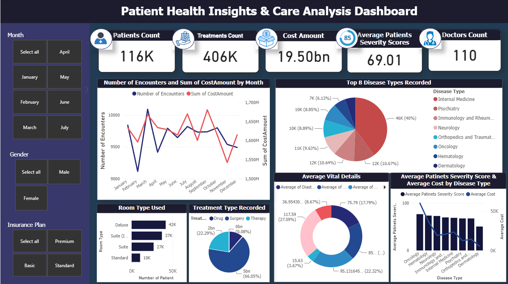
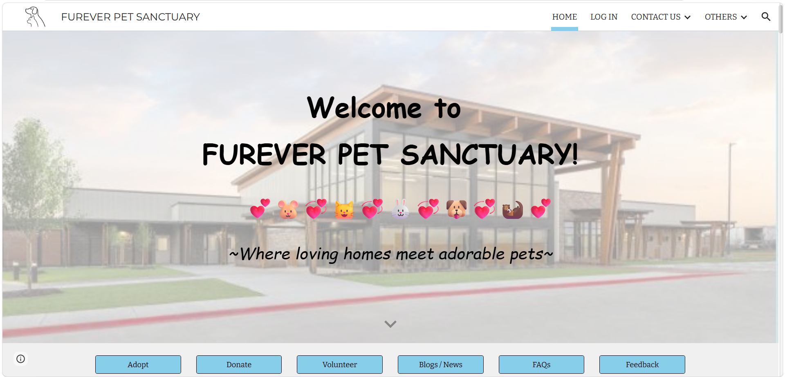

---
title: Projects
permalink: /projects/
---

[Home]({{ '/' | relative_url }}) | [About Me]({{ '/about/' | relative_url }}) | [Experience]({{ '/experience/' | relative_url }}) | [Skills]({{ '/skills/' | relative_url }})

# My Projects

Explore my selected projects showcasing my skills in data analytics, machine learning, natural language processing (NLP), interactive dashboard development, and website design, with a focus on practical, data-driven solutions and creative innovation.

## An AI-Driven Big Data and Deep Learning Framework for Complaint Detection and Risk Severity Assessment on Online Food Delivery Platforms

  

**Key components**
- Text preprocessing and exploratory data analysis
- LSTM-based customer complaints classification
- Complaint categorization and risk severity scoring
- Streamlit dashboard for presenting insights

**Technologies:** Python, Pandas, TensorFlow/Keras, NLTK, Streamlit

[View Full Case Study](projects/food-delivery-risk.md)

 

## Sentiment Analysis on Balancing Innovation and Security in Generative AI (GenAI)

  

**Key components**
- Text preprocessing and sentiment labelling
- TF-IDF feature extraction
- Comparison of machine learning classifiers
- Topic modelling to identify discussion themes

**Technologies:** Python, Pandas, Scikit-learn, NLTK

[View Full Case Study](generative-ai-sentiment/)

 

## Analyzing Crime Distribution and Prevention Strategies in Malaysia

  

**Key components**
- Data preprocessing, cleaning, and predictive model development
- Model performance evaluation and analytical interpretation
- Interactive Streamlit application and dashboard development
- Predictive analytics and spatial analysis of crime distribution

**Technologies:** Python, Pandas, LightGBM Model, Streamlit

[View Full Case Study](crime-analysis/)

 

## Design and Implementation of a Data Warehouse for Healthcare Analytics to Support Public Health Decision-Making

  

**Key components**
- Data preprocessing, cleaning, and predictive model development (need to be updated)
- Model performance evaluation and analytical interpretation
- Interactive Streamlit application and dashboard development
- Predictive analytics and spatial analysis of crime distribution

**Technologies:** Python, Pandas, LightGBM Model, Streamlit

[View Full Case Study](crime-analysis/)

 

## PAW TRACK ADOPTION SYSTEM: FUREVER PET SANCTUARY SITE

  

**Key components**
- Data preprocessing, cleaning, and predictive model development (need to be updated)
- Model performance evaluation and analytical interpretation
- Interactive Streamlit application and dashboard development
- Predictive analytics and spatial analysis of crime distribution

**Technologies:** Python, Pandas, LightGBM Model, Streamlit

[View Full Case Study](crime-analysis/)

 

## LEVERAGING DATA ANALYTICS FOR URBAN PLANNING: TOWRADS SUSTAINABLE, SMART AND RESILIENT CITY AMID RESPONSIBLE ENERGY CONSUMPTION

  

**Key components**
- Data preprocessing, cleaning, and predictive model development (need to be updated)
- Model performance evaluation and analytical interpretation
- Interactive Streamlit application and dashboard development
- Predictive analytics and spatial analysis of crime distribution

**Technologies:** Python, Pandas, LightGBM Model, Streamlit

[View Full Case Study](crime-analysis/)

