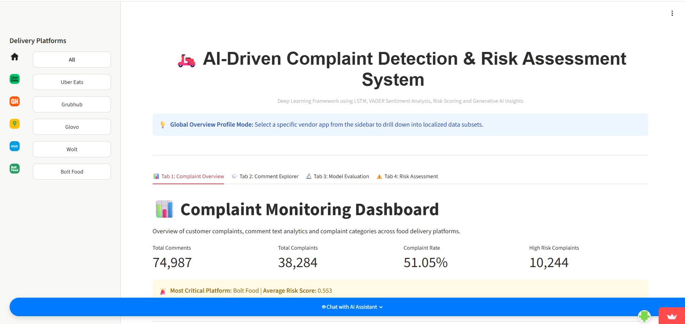
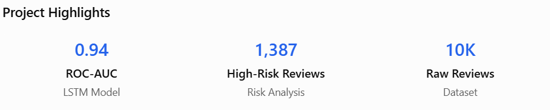

---
title: AI-Based Customer Complaint Risk Detection
permalink: /projects/food-delivery-risk/
---

[Home](../README.md) | [All Projects](../projects.md)

# An AI-Driven Big Data and Deep Learning Framework for Complaint Detection and Risk Severity Assessment on Online Food Delivert Platforms 

  

## Project Overview

This project explores how deep learning, big data and cloud computing and risk analysis concepts can be applied to customer complaints on online food delivery platforms.

The objective is to classify complaint-related feedback and assess potential risk severity, helping managers to identify issues that may require further investigation.

## Objectives

1. To develop and compare LSTM and GRU deep learning models in detecting and classifying complaint comments from food delivery platform reviews.
2. To build a structured cloud-based big data pipeline for ingestion, processing, storage, and analysis for a large-scale customer review data to support decision-making in transforming raw user-generated contents into a reliable and high-quality data.
3. To assess risk severity level using a probabilistic risk scoring model based on sentiment polarity, customer ratings, complaint categories and frequencies.

## Tools and Technologies

- Python
- Pandas and NumPy
- TensorFlow / Keras
- Natural Language Processing
- Matplotlib / Seaborn
- Streamlit

## Methodology

### 1. Dataset Collection and Preparation
Collected and stored food delivery platform reviews in Google Drive. Filtered English-language reviews from 2020–2024 and applied random sampling of up to 500 reviews per year to obtain a manageable dataset for analysis.

### 2. Feature Extraction and Complaint Identification
Extracted key features, including review dates, customer comments, ratings, and platform names. Used customer ratings to establish complaint labels, classifying reviews with ratings below 2 as complaints and ratings above 2 as non-complaints.

### 3. Text Preprocessing and Exploratory Data Analysis
Performed text cleaning, including lowercase conversion, URL and special character removal, tokenization, stop-word removal, and lemmatization. Categorized complaints into nine issue types and applied VADER for sentiment classification (positive, neutral, and negative). Conducted EDA to identify customer feedback patterns and complaint trends.

### 4. Deep Learning Model Development
Developed and compared LSTM and GRU models using an 80:20 training-testing split. Evaluated model performance using accuracy, precision, recall, F1-score, confusion matrices, ROC-AUC, and training/testing loss curves to select the most suitable model for complaint classification.

### 5. Complaint Risk Assessment
Developed a weighted risk scoring framework using four indicators: sentiment severity, rating severity, complaint frequency, and complaint category weight. Classified complaints into Low, Medium, and High risk levels and visualized the results using risk matrices, complaint distribution charts, and risk score comparisons.

### 6. Big Data Architecture and Application Deployment
Designed a four-layer analytical architecture covering data ingestion and storage, data processing, analytical modelling, and application visualization. Integrated the workflow into an interactive Streamlit dashboard, enabling users to monitor customer complaints, explore platform-level trends, and identify high-risk issues.

## Key Findings

  

### 1. Deep Learning Performance
The LSTM model outperformed the GRU model and was selected as the final classification model, achieving approximately **88% recall and 0.94 ROC-AUC**, demonstrating its ability to identify complaint-related reviews.

### 2. Complaint Risk Analysis
Identified **1,387 high-risk reviews**, with payment and refund issues emerging as the most prominent high-risk category across most platforms. Bolt Food also showed notable high-risk patterns in delivery, order accuracy, and customer service complaints.

### 3. Application Development
Successfully integrated data processing, deep learning classification, and risk assessment into a Streamlit application, processing approximately **10,000 raw reviews** and providing interactive visualizations for complaint monitoring and risk analysis.

## Project Links

- Dataset: [Food Delivery Apps Reviews on Kaggle](https://www.kaggle.com/datasets/skamlo/food-delivery-apps-reviews)
- GitHub Source Code: [GitHub Repository](https://github.com/XINnn2/FOOD)
- Live Streamlit App: [Food Delivery Complaints Apps](https://complaint-system.streamlit.app/)
- Finding Report: [Report](https://canva.link/78hec0napcbogm4)

 
 

[Back to Previous Page](../projects.md)

