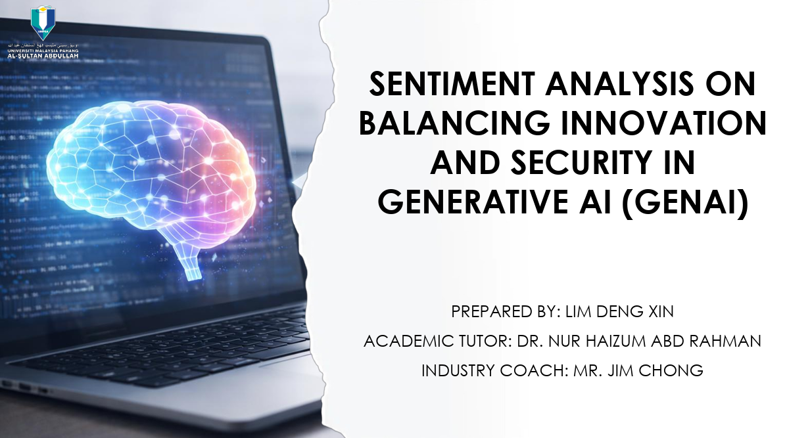

---
title: Sentiment Analysis on Balancing Innovation and Security in Generative AI (GenAI)
permalink: /projects/food-delivery-risk/
---

[Home](../README.md) | [All Projects](../projects.md)

# Sentiment Analysis on Balancing Innovation and Security in Generative AI (GenAI)

  

## Project Overview

This project investigates public sentiment towards Generative Artificial Intelligence (GenAI) in Malaysia, focusing on the balance between technological innovation and security concerns.

As GenAI tools such as ChatGPT become increasingly integrated into everyday activities, they offer benefits in productivity, efficiency, and automation. However, their growing adoption also raises concerns about data privacy, information security, ethical issues, and potential misuse.

Using Natural Language Processing (NLP), machine learning, and topic modelling, this project analyses public discussions on YouTube to understand Malaysians' perceptions of GenAI and identify key themes influencing public opinion.

## Objectives

1. To examine Malaysians’ sentiment toward the development of generative AI in innovation and security through sentiment analysis.
2. To apply machine learning algorithms to classify different levels of sentiment (positive, neutral and negative).
3. To evaluate performance of multiple machine learning models in predicting sentiment outcomes using performance metrics comparison such as accuracy, precision, recall, F1-score and confusion matrix.

## Tools and Technologies

- Python 3.12.12
- Pandas and NumPy
- Scikit-learn
- Natural Language Processing (NLP)\
- TF-IDF Vectorization
- Multinomial Logistic Regression
- Multinomial Naïve Bayes
- Support Vector Machine (SVM)
- Latent Dirichlet Allocation (LDA)
- Microsoft Excel

## Methodology

This project follows the Data Science Methodology Cycle, covering business understanding, data collection, data preparation, modelling, evaluation, and recommendations.

### 1. Business Understanding
Established the research focus on understanding Malaysian public perceptions of GenAI, particularly its innovation benefits, security risks, and data privacy concerns. This project adopted three analytical approaches.
- **Descriptive Analytics:** Examined overall sentiment distributions and public discussion patterns.
- **Predictive Analytics:** Developed machine learning models to classify sentiment into positive, neutral, and negative polarities.
- **Prescriptive Analytics:** Formulated recommendations for policymakers, AI developers, and relevant stakeholders to encourage responsible GenAI adoption.

### 2. Data Collection and Sources
Collected publicly available YouTube comments discussing GenAI through web scraping.

- **Source:** YouTube public comments.
- **Keywords:** "Generative AI Malaysia", "AI Adoption Malaysia", "AI Security Malaysia", and "ChatGPT Data Privacy".
- **Collection Date:** 18 December 2025, 7:00 PM.
- **Dataset Size:** 17,960 comments.
  
Extracted relevant information, including video IDs, comments, publication dates, and language labels.

### 3. Data Understanding and Preparation
Used Python 3.12.12 to prepare and clean the collected text data.

Performed text preprocessing through:

- Lowercase conversion.
- URL and emoticon removal.
- Special character and punctuation removal.
- Tokenization.
- English and Malay stop-word removal, including additional English noise words.
- Lemmatization.

### 4. Sentiment Analysis and Feature Extraction
Applied sentiment analysis to categorise comments into positive, neutral, and negative sentiment.

Used TF-IDF (Term Frequency–Inverse Document Frequency) with unigram and bigram features to transform textual comments into numerical representations for machine learning.

### 5. Machine Learning Models Development
Developed and compared three machine learning algorithms:

- **Multinomial Logistic Regression:** Established a linear classification baseline for sentiment prediction.
- **Multinomial Naïve Bayes:** Applied probabilistic classification based on word occurrence patterns.
- **Support Vector Machine (SVM):** Identified optimal decision boundaries to distinguish sentiment categories in high-dimensional text data.

Partitioned the 17,960 comments into training and testing datasets using an 80:20 ratio.

### 6. Topic Modelling Using LDA
Applied Latent Dirichlet Allocation (LDA) to identify recurring themes and hidden discussion patterns within GenAI-related comments.

Used coherence scores to evaluate topic quality and support the selection of an appropriate number of topics.

### 7. Model Evaluation

Evaluated the machine learning models using accuracy, precision, recall, F1-score, Confusion Matrix and ROC-AUC Score to identify the most suitable model for analysing public sentiment towards GenAI.

### 8. Recommendations and Insights
Presented the analytical findings to develop recommendations for policymakers, AI developers, and stakeholders, focusing on data privacy awareness, security practices, ethical AI development, and responsible GenAI adoption.

## Key Findings

### 1. Public Sentiment Towards GenAI
- 49.0% Positive, 25.8% Neutral, and 25.2% Negative sentiment.
- Malaysian public discussions generally reflected positive perceptions of GenAI and its innovation benefits.
- The strongest discussion theme was Public Perception and Everyday Use of GenAI.

### 2. Best Performing Machine Learning Model
- Support Vector Machine (SVM) achieved the strongest overall classification performance among the three evaluated models.
- SVM demonstrated its suitability for high-dimensional textual data through TF-IDF feature extraction.
- Logistic Regression provided a linear classification baseline, while Naïve Bayes showed limitations in capturing relationships between words and contextual meaning.

### 3. Model Evaluation Insights
Some models demonstrated relatively strong ROC-AUC scores (≥ 0.94) despite lower precision or recall at the selected classification thresholds.

This highlights the difference between threshold-based classification performance and a model's ability to distinguish between sentiment classes across different thresholds.

### 4. Key Implications
GenAI is increasingly recognised for its potential to improve productivity and support everyday activities.

Despite generally positive sentiment, concerns remain regarding data privacy, information security, ethical risks, and potential misuse.

The findings highlight the importance of balancing technological innovation with security awareness and responsible AI adoption.

## Project Links

- Dataset: [Food Delivery Apps Reviews on Kaggle](https://www.kaggle.com/datasets/skamlo/food-delivery-apps-reviews)
- GitHub Source Code: [GitHub Repository](https://github.com/XINnn2/FOOD)
- Finding Report: [Report](https://canva.link/78hec0napcbogm4)

 
 

[Back to Previous Page](../README.md)
