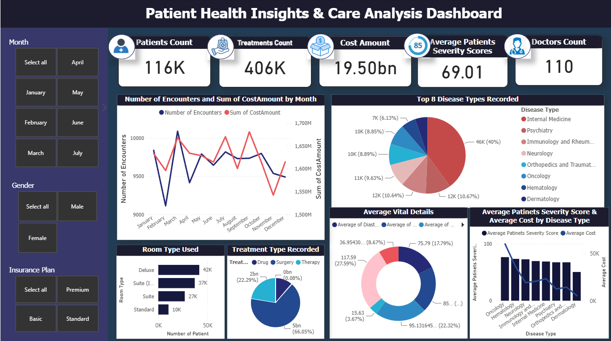

[Home](../README.md) | [All Projects](../projects.md)

# Design and Implementation of a Data Warehouse for Healthcare Analytics to Support Public Health Decision-Making

  

## Project Overview

This project focuses on designing and implementing a healthcare data warehouse to integrate, organize, and analyse electronic medical record (EMR) data. The system applies data warehousing concepts to support healthcare analytics, improve data accessibility, and provide insights into patient conditions, medical treatments, and healthcare resource utilization.

## Objectives

1. To design a healthcare data warehouse using a Snowflake Schema to organize fact and dimension tables and maintain structured data relationships.
2. To develop an ETL pipeline to extract, transform, validate, and load healthcare datasets into a centralized database.
3. To apply SQL-based OLAP operations and Power BI visualizations to analyse healthcare trends and support data-driven decision-making.

## Tools and Technologies

- Python (Pandas)
- Google Colab
- PostgreSQL / pgAdmin 4
- SQL
- Power BI
- Snowflake Schema
- ETL (Extract, Transform, Load)
- OLAP (Online Analytical Processing)

## Methodology

### 1. Dataset Collection and Preparation
Collected healthcare datasets from Kaggle, covering patient demographics, medical conditions, treatments, laboratory tests, vital records, insurance, and hospital encounters. Prepared the datasets in CSV format for further processing and integration.

### 2. Data Cleaning and Transformation
Used Python and Pandas in Google Colab to inspect dataset structures, validate data types and date formats, and check for missing and duplicate records. Applied the necessary filtering and formatting to ensure data consistency before loading.

### 3. Data Warehouse Design
Designed a Snowflake Schema consisting of multiple fact and dimension tables to organize healthcare information. Established relationships between tables using primary and foreign keys to support structured data storage, reduce redundancy, and maintain referential integrity.

### 4. ETL Pipeline Implementation
Implemented the Extract, Transform, and Load (ETL) process using Google Colab and pgAdmin 4. Exported the transformed datasets from Colab and loaded them into the PostgreSQL database, making the structured data available for SQL queries and further analysis.

### 5. OLAP Analysis Using SQL
Applied five OLAP operations using SQL in pgAdmin 4: Roll-up, Drill-down, Slicing, Pivot, and Dicing. Analysed patient encounters, disease categories, disease severity, patient demographics, and treatment-related records from different perspectives.

### 6. Data Visualization and Dashboard Development
Developed an interactive Power BI dashboard to present healthcare insights for 2024. Included key performance indicators, patient encounter trends, disease distributions, treatment records, room utilization, vital statistics, and patient severity analysis, with filters for month, gender, and insurance plan.

## Key Findings

### 1. Healthcare Data Overview
The dashboard summarized approximately 116,000 patients, 406,000 treatments, and 110 doctors recorded in the 2024 dataset, providing an overview of healthcare activities and resource utilization.

### 2. Patient and Treatment Insights
Internal Medicine recorded the highest number of patient encounters among the displayed disease categories. Surgery was also the most frequently recorded treatment type, accounting for approximately 66.05% of treatment records.

### 3. Healthcare Cost and Severity Analysis
Oncology recorded the highest average patient severity score (76.53), while Dermatology recorded the lowest (50.41). The dashboard also presented treatment costs and patient severity across disease categories to support healthcare resource planning.

[Back to Previous Page](../projects.md)
