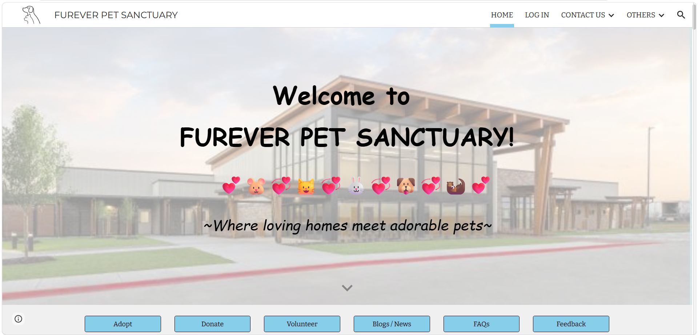

---
title: Paw Track Adoption System: Furever Pet Sanctuary Site
permalink: /projects/food-delivery-risk/
---

[Home](../README.md) | [All Projects](../projects.md)

# Paw Track Adoption System: Furever Pet Sanctuary Site

  

## Project Overview

Furever Pet Sanctuary Site is a website project designed to connect rescued animals with potential adopters and promote responsible pet ownership. The platform provides an accessible space for users to explore available pets, learn about adoption procedures, and discover ways to support animal welfare.

## Objectives

1. To design and organize a structured database for managing pet information, adoption records, and sanctuary-related information.
2. To collaborate with team members in developing a user-friendly website interface that simulates the daily operations and services of a real-world pet sanctuary.
3. To integrate information management and website features to support pet adoption, donation, volunteer coordination, and communication with potential adopters.

## Tools and Technologies

- **Website Development:** Google Sites
- **Online Registration Forms:** Google Forms
- **Content Organization:** Multi-page website structure

## Key Features

### 1. Pet Adoption Directory
Organized pet listings by animal category, including dogs, cats, rabbits, hamsters, and ferrets. Each listing provides basic pet information and access to individual details.

### 2. Adoption Information
Provides adoption guidelines, application steps, and frequently asked questions to help potential adopters understand the adoption process.

### 3. Donation and Volunteer Support
Includes dedicated sections explaining donation options and volunteer opportunities to encourage community involvement in animal welfare.

### 4. News and Success Stories
Features pet adoption stories, animal care articles, upcoming events, and sanctuary updates to keep visitors informed and engaged.

### 5. Feedback and Communication
Provides feedback forms and contact information to encourage visitor interaction and collect suggestions for website improvement.

## Project Outcome
Developed a multi-page pet adoption website that organizes adoption information and animal listings into an accessible platform. The project strengthened my understanding of website development, content organization, user experience, and designing digital platforms around user needs.

## Project Link
[Live Website](https://sites.google.com/view/furever-pet-sanctuary/home)

[Back to Previous Page](../projects.md)
