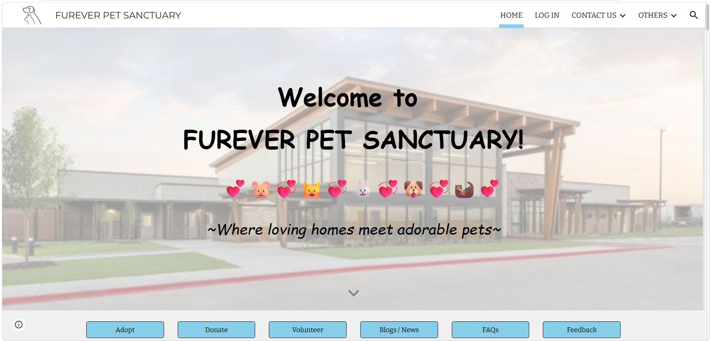

---
title: Paw Track Adoption System: Furever Pet Sanctuary Site
---

[Home](../index.md) | [All Projects](../projects.md)

# Paw Track Adoption System: Furever Pet Sanctuary Site

  

**Tools:** Google Sites, Google Forms

---

## Project Overview

Furever Pet Sanctuary Site is a website project designed to connect rescued animals with potential adopters and promote responsible pet ownership. The platform provides an accessible space for users to explore available pets, learn about adoption procedures, and discover ways to support animal welfare.

---

## Objectives

1. To design and organize a structured database for managing pet information, adoption records, and sanctuary-related information.
2. To collaborate with team members in developing a user-friendly website interface that simulates the daily operations and services of a real-world pet sanctuary.
3. To integrate information management and website features to support pet adoption, donation, volunteer coordination, and communication with potential adopters.

---

## My Contributions

1. Helped organise website content and page structure.
2. Supported the development of pet adoption information and listings.
3. Contributed to features for adoption applications, donations and volunteering.
4. Helped create a user-friendly platform for visitors.

---

## Project Outcome

Developed a multi-page website that presents pet information and adoption services in an organised and accessible way.

This project strengthened my understanding of website structure, information management and user-focused design.

---

## Project Link
[Live Google Site Website](https://sites.google.com/view/furever-pet-sanctuary/home)

---

[Back to Projects](../projects.md)
