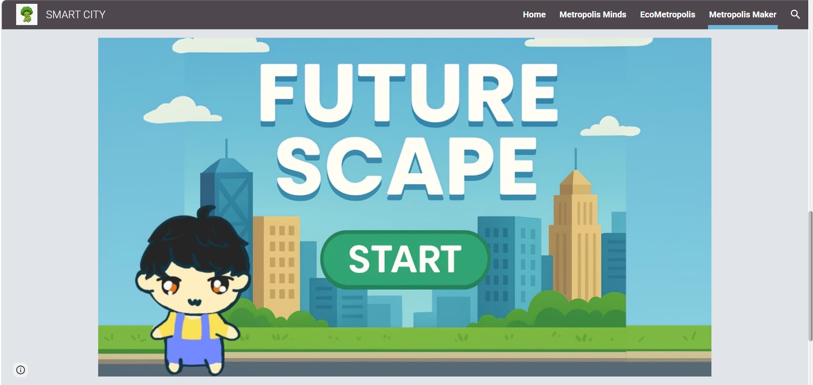

---
title: Leveraging Data Analytics For Urban Planning: Towards Sustainable, Smart And Resilient City Amid Responsible Energy Consumption
permalink: /projects/food-delivery-risk/
---

[Home](../README.md) | [All Projects](../projects.md)

# Leveraging Data Analytics For Urban Planning: Towards Sustainable, Smart And Resilient City Amid Responsible Energy Consumption

  

## Project Overview

This project explores sustainable urban planning, smart-city development, and responsible energy consumption. Working with team members, I contributed to the website, while independently developing an interactive game using Scratch to present the project's theme through a gaming experience.

## Objectives

1. To explore the concepts of sustainable urban planning, smart cities, and responsible energy consumption through an interactive project.
2. To design and develop a Scratch game that communicates the project's theme through interactive gameplay.
3. To collaborate with team members in creating a website to present the competition concept and project information.

## Tools and Technologies

- **Game Development:** Scratch
- **Website Development:** Google Sites

## Individual Game Development

  

Independently designed and developed an interactive game using Scratch, applying programming logic and interactive elements to create a playable experience. This project allowed me to explore basic game development concepts, creativity, and problem-solving through visual programming.

[Play the Game](https://scratch.mit.edu/projects/1158383038)

## Project Website
Collaborated with team members to develop a Google Sites website presenting the competition concept, Metropolis Maker, and its focus on sustainable and resilient urban development.

[Website](https://sites.google.com/view/smart-city-insight/metropolis-maker?pli=1&authuser=0)

## Project Outcome
Gained practical experience in independent game development using Scratch, visual programming, and teamwork. The project also strengthened my ability to translate a sustainability-related concept into an interactive digital experience.

[Back to Previous Page](../projects.md)
