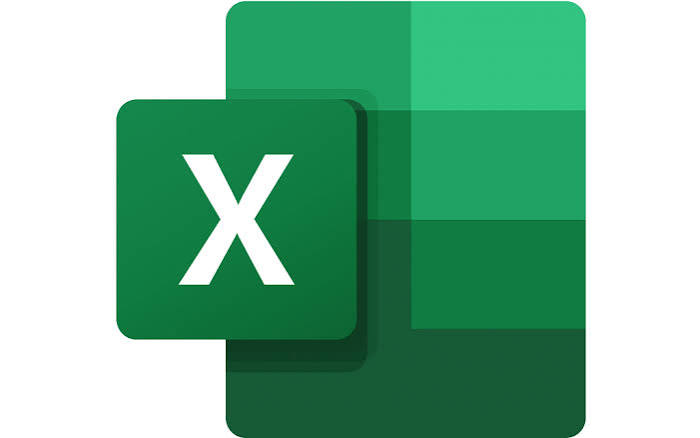
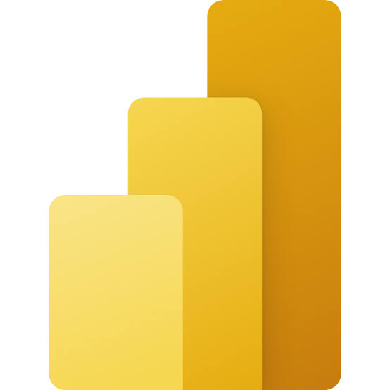
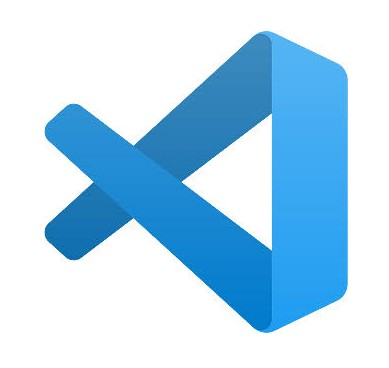

---
title: Skills & Tools
permalink: /skills/
---

[Home](README.md) | [About Me](about.md) | [Projects](projects.md) | [Experiences](experience.md)

# Skills & Tools

*A showcase of my technical abilities, analytical knowledge, programming tools and continuous learning journey in Data Analytics.*

---

## My Technical Profile

I am an aspiring Data Analyst pursuing a Bachelor of Applied Science in Data Analytics with Honours at Universiti Malaysia Pahang Al-Sultan Abdullah (UMPSA).

With a strong academic foundation and a passion for statistics, programming, data analysis and visualization, I have developed skills in using Microsoft Excel, Python, Power BI and SQL to process, analyze and present data.

Through academic projects, practical assignments and industrial training, I have gained experience in exploratory data analysis, data visualization, data management, statistical analysis and research support. I am particularly interested in transforming raw data into meaningful insights and presenting analytical findings to support informed decision-making.

  

### My Key Areas

| Area | Focus |
|:---|:---|
| Data Analytics | Data Cleaning · Data Preparation · Exploratory Data Analysis |
| Data Visualization | Power BI · Excel Charts · Dashboard Development |
| Programming | Python · R Programming · C Programming |
| Database & Management | SQL · Database Management · Data Validation |
| Data Science | Machine Learning · Deep Learning · Natural Language Processing |
| Research & Reporting | Statistical Analysis · Research Support · Data Interpretation |

---

## Technical Skills

A summary of the technical and analytical skills I have developed through academic learning, practical assignments, projects and industrial training.

### Data Analytics & Visualization

- Data Cleaning and Preparation
- Exploratory Data Analysis (EDA)
- Data Visualization
- Statistical Analysis
- Dashboard Development
- Data Interpretation and Reporting
- Data Validation and Consistency Checking

### Programming & Data Science

- Python Programming
- R Programming
- C Programming
- Machine Learning (Project-based)
- Deep Learning (Project-based)
- Natural Language Processing (NLP)
- Sentiment Analysis

### Database & Data Management

- SQL
- Relational Database Concepts
- Database Management
- Data Organization and Filtering
- Data Quality Checking

### Research & Analytical Skills

- Research Data Collection
- Market and Industry Research
- Data Verification and Validation
- Analytical Thinking
- Problem Solving
- Report Preparation
- Teamwork and Communication

---

## Tools & Technologies

The following are the tools and technologies I have explored and applied throughout my academic projects, practical assignments and industrial training.

### 1. Python

  

**Programming | Data Analysis | Machine Learning**

Python is one of the main programming languages I use for data analysis and data science projects. I have applied it to process datasets, perform exploratory data analysis, develop machine learning models and explore natural language processing techniques.

**Areas of Application:**
- Data processing and manipulation
- Exploratory data analysis
- Machine learning model development
- Deep learning experiments
- Sentiment analysis and NLP
- Data visualization

**Related Projects:**
- An AI-Driven Big Data and Deep Learning Framework for Complaint Detection and Risk Severity Assessment on Online Food Delivery Platforms
- Sentiment Analysis on Balancing Innovation and Security in Generative AI

[Explore My Projects →](projects.md)

---

### 2. Microsoft Excel

  

**Data Management | Data Analysis | Data Validation | Reporting**

Microsoft Excel is one of the tools I frequently use for organizing, processing and analyzing data. I have applied Excel in both academic activities and practical working environments to perform calculations, prepare charts, organize research information and check data consistency.

**Areas of Application:**
- Data organization and management
- Spreadsheet calculations and analysis
- Data comparison and verification
- Chart and report preparation
- Data validation and consistency checking

**Practical Experience:**

During my industrial training at Cardas Research & Consulting Group, I used Excel to support industry research reports, organize research information, prepare charts and compare data records to ensure accuracy and consistency.

I also gained earlier working experience handling sales records and invoices using Excel to estimate business profits and losses.

[Explore My Industrial Training →](experiences/crcg.md)

---

### 3. Microsoft Power BI

  

**Business Intelligence | Data Visualization | Dashboard Development**

Power BI is one of the key tools in my data analytics skill set. I have explored its application in presenting data through interactive visualizations and dashboards to make information easier to understand and interpret.

**Areas of Application:**
- Data visualization
- Dashboard development
- Analytical result presentation
- Business and performance reporting
- Data-driven decision support

**Related Academic Work:**
- Healthcare Analytics Dashboard
- Data Visualization and Reporting Projects

[Explore My Projects →](projects.md)

---

### 4. SQL

  

**Database Management | Data Querying | Data Organization**

SQL is an important part of my data analytics foundation. Through academic learning and database-related projects, I have explored relational database concepts and the use of SQL for organizing, retrieving and managing structured data.

**Areas of Application:**
- Relational database concepts
- Data retrieval and querying
- Database organization
- Structured data management
- Database design and development

**Related Projects:**
- Design and Implementation of a Data Warehouse for Healthcare Analytics to Support Public Health Decision-Making

[Explore My Projects →](projects.md)

---

### 5. R Programming

  

**Statistical Computing | Data Analysis | Visualization**

I have used R programming for statistical analysis, data processing and developing analytical applications. It has also allowed me to explore interactive dashboard development and communicate analytical findings through visual representations.

**Areas of Application:**
- Statistical analysis
- Data manipulation
- Data visualization
- Interactive dashboard development

**Related Project:**
- XPCPlus Student Engagement Dashboard (R Shiny)

[Explore My Projects →](projects.md)

---

### 6. Google Colab

  

**Cloud-Based Development | Python Programming | Machine Learning**

Google Colab is one of the development environments I use to write and execute Python code, process datasets and experiment with analytical and machine learning models.

**Areas of Application:**
- Python programming
- Dataset processing
- Exploratory data analysis
- Machine learning experiments
- Model development and evaluation

**Related Projects:**
- Food Delivery Complaint Risk Detection
- Sentiment Analysis on Generative AI

[Explore My Projects →](projects.md)

---

### 7. Streamlit

  

**Interactive Applications | Dashboard Development | Model Integration**

I have used Streamlit to develop interactive web applications that present analytical results and machine learning outputs through a user-friendly interface.

**Areas of Application:**
- Interactive application development
- Data visualization
- Dashboard development
- Machine learning model integration
- Analytical result presentation

**Related Project:**
- An AI-Driven Big Data and Deep Learning Framework for Complaint Detection and Risk Severity Assessment on Online Food Delivery Platforms
- Analyzing Crime Distribution and Prevention Strategies in Malaysia

[Explore My Projects →](projects.md)

---

### 8. C Programming

  

**Programming Fundamentals | Logical Thinking | Problem Solving**

I have gained programming experience in C through academic learning and practical programming exercises. This has helped me develop foundational programming knowledge and logical problem-solving skills.

**Areas of Application:**
- Programming fundamentals
- Logical problem solving
- Basic algorithm implementation
- Structured programming

---

### 9. GitHub & Visual Studio Code

  
  &nbsp;&nbsp;
  

**Development Environment | Version Control | Portfolio Management**

I use GitHub and Visual Studio Code to organize project files, write and manage code, maintain project repositories and develop my personal portfolio website.

**Areas of Application:**
- Code development and editing
- Repository management
- Project documentation
- Portfolio development using GitHub Pages
- Organizing academic and personal projects

[Visit My GitHub Profile →](https://github.com/Xinnn345)

---

## Certifications & Continuous Learning

I believe continuous learning is important in developing technical knowledge and keeping up with the evolving field of data analytics and technology.

  

**Certificate Name**

Issuing Organization | Completion Year

[View Certificate →](#)

*Additional certificates and learning achievements will be added as I continue developing my technical knowledge.*

---

## Additional Achievements & Learning Experiences

### 🌏 Chinese Government Scholarship International Summer School

**Hebei University | China | 2025**

An international academic and cultural exchange programme that broadened my exposure to Big Data, Artificial Intelligence, Data Analytics, Digital Finance, E-commerce and Digitalization.

[Explore This Experience →](experience/hebei-summer-school.md)

### 🌱 Go Green Competition

**Smart and Sustainable City Project**

Participated in a group competition focused on leveraging data analytics for urban planning towards a sustainable, smart and resilient city amid responsible energy consumption.

[Explore Competition Website →](https://sites.google.com/view/smart)

---

## My Learning Journey

Every project, assignment and experience has contributed to my growth in data analytics and technology. Through continuous learning and practical application, I aim to strengthen my programming, analytical and visualization skills.

I look forward to exploring new technologies, developing meaningful projects and applying data-driven approaches to solve real-world problems.

---

[← Back to Previous Page](README.md)
